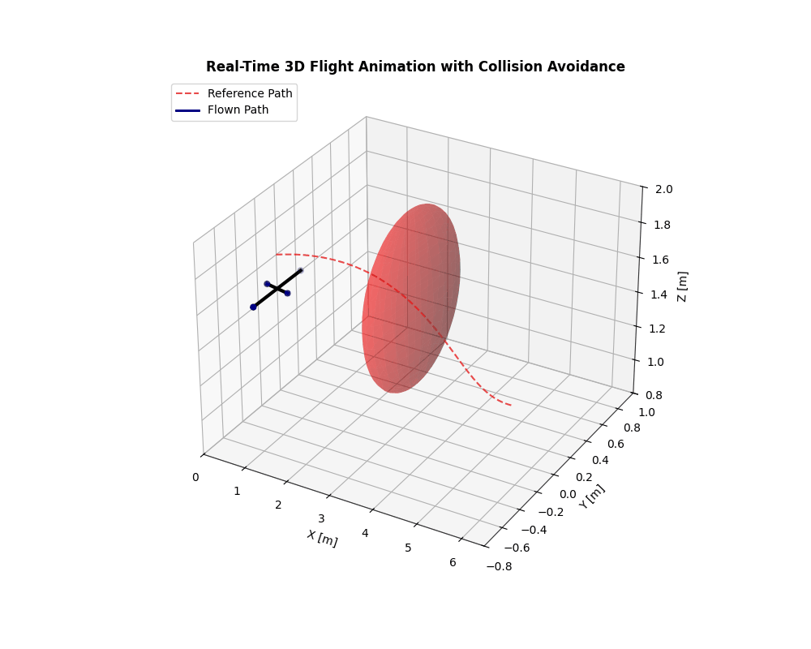
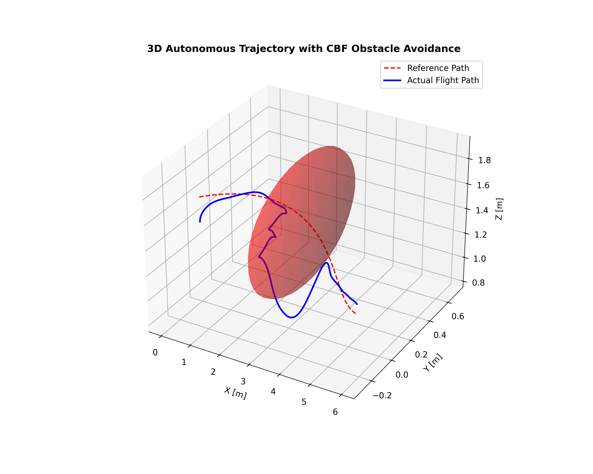

# Autonomous Quadrotor Obstacle Avoidance via Obstacle-Aware NMPC & Disturbance-Aware EKF

A modular Python framework for robust 3D trajectory tracking and certified collision-free flight of an underactuated multi-rotor aerial robot under external wind disturbances.



## Project Telemetry
Below is the full closed-loop system performance telemetry showing tracking error minimization, disturbance estimation, and obstacle distance buffer maintenance:



## Key Features
- **6-DOF Nonlinear Dynamics:** Full rigid-body model integrated with Runge-Kutta 4th order (RK4).
- **Disturbance-Aware EKF:** Augmented 15-state estimator tracking robot states and estimating external aerodynamic forces in real time.
- **Obstacle-Aware NMPC:** Multiple-shooting nonlinear MPC formulated with CasADi & IPOPT, incorporating hard geometric safety envelopes.
- **Real-Time 3D Visualization:** Dynamic 3D flight animation and telemetry logging via Matplotlib.

## Repository Structure
- `quadrotor_model.py`: 6-DOF physics engine and RK4 integrator.
- `ekf_estimator.py`: Augmented Extended Kalman Filter for state and wind estimation.
- `nmpc_controller.py`: CasADi-based nonlinear model predictive controller.
- `visualizer.py`: 2D telemetry plotting and live 3D animation renderer.
- `main.py`: Closed-loop simulation orchestrator.

## Quickstart
```bash
python -m venv venv
.\venv\Scripts\Activate.ps1
pip install -r requirements.txt
python main.py